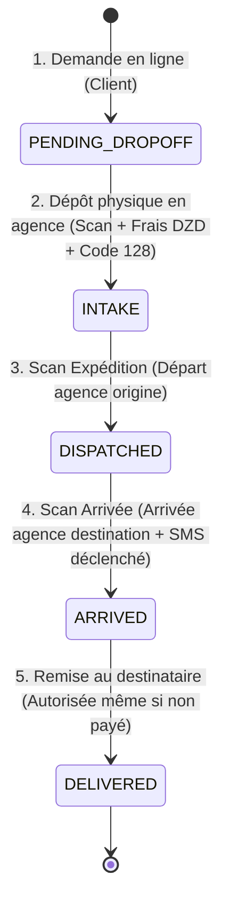

# Khaled Express — Prototype Logistique Alger ⮀ El Eulma

> **Prototype opérationnel complet** pour le transfert de colis entre deux bureaux fixes : **Alger (Centre-Ville)** et **El Eulma (Sétif)**.
> Conforme au plan d'implémentation et à la suite de tests de validation.

---

## 🚀 Architecture & Fonctionnalités

```
khaled-express/
├── backend/                       # API REST Django (Python 3.11)
│   ├── khaled_express/            # Configuration projet, CORS, Auth
│   ├── api/                       # Modèles, Sérialiseurs, Vues, Permissions
│   │   ├── models.py              # Office, User, Parcel, ScanEvent, Payment, Expense, SmsOutbox
│   │   ├── views.py               # Cycle de vie, Scans de garde, Bons, Finance, IA
│   │   ├── barcode_utils.py       # Générateur vectoriel Code 128 (SVG) natif
│   │   ├── sms_service.py         # File d'attente SMS localisée & idempotente
│   │   ├── ai_service.py          # Assistant IA opérationnel en lecture seule
│   │   └── permissions.py         # Ségrégation stricte des rôles (Admin vs Modérateur)
│   ├── seed_data.py               # Données de démonstration pré-chargées
│   └── test_prototype.py          # Suite de tests d'acceptation automatisée
│
├── frontend/                      # Application Web & Bureau (React 18 + Vite + Tailwind CSS)
│   ├── src/
│   │   ├── i18n/                  # Bilingue Français / Arabe avec support RTL complet
│   │   ├── components/
│   │   │   ├── Navbar.tsx         # Sélecteur d'agence, commutateur de rôles, langue
│   │   │   ├── BarcodeDisplay.tsx # Rendu Code 128 vectoriel
│   │   │   ├── ScannerModal.tsx   # Station de scan (douchette USB + visée laser)
│   │   │   ├── PrintBonsModal.tsx # Ticket thermique 80mm + Bon de Dépôt + Bon de Retrait
│   │   │   └── AiAssistantModal.tsx # Assistant IA conversationnel en lecture seule
│   │   ├── pages/
│   │   │   ├── CustomerPortal.tsx # Suivi temps réel, demandes en ligne, "Mes Colis"
│   │   │   ├── StaffOperations.tsx # Dépôt/Intake, Expédition, Arrivée, Remise client
│   │   │   ├── FinanceDashboard.tsx # Trésorerie DZD réservée Admin (Paiements, Dépenses)
│   │   │   └── SmsOutboxView.tsx  # Visualiseur des SMS générés à l'arrivée
│   │   └── services/api.ts        # Client API connecté au backend
│   └── src-tauri/                 # Configuration Rust / Tauri pour application bureau native
│
├── docker-compose.yml             # Orchestration complète (PostgreSQL, Redis, API, Web, Worker)
├── Dockerfile.backend
├── Dockerfile.frontend
└── nginx.conf
```

---

## 🛡️ Rôles & Sécurité (RBAC)

| Fonctionnalité | Client (`CUSTOMER`) | Modérateur (`MODERATOR`) | Administrateur (`ADMIN`) |
| :--- | :---: | :---: | :---: |
| **Suivi public de colis** | ✅ | ✅ | ✅ |
| **Créer demande en ligne** | ✅ | ✅ | ✅ |
| **Consulter ses propres colis** | ✅ (filtré) | ✅ (tous) | ✅ (tous) |
| **Enregistrer colis au guichet** | ❌ | ✅ | ✅ |
| **Scans d'expédition & d'arrivée** | ❌ | ✅ | ✅ |
| **Remise client (même impayé)** | ❌ | ✅ | ✅ |
| **Impression ticket 80mm & bons** | ❌ | ✅ | ✅ |
| **Accès écran Finance** | ❌ *(403)* | ❌ *(403 Verrouillé)* | ✅ |
| **Fixer / modifier les frais** | ❌ | ❌ | ✅ |
| **Saisir règlements (Paiements)** | ❌ | ❌ | ✅ |
| **Saisir charges (Dépenses)** | ❌ | ❌ | ✅ |
| **Assistant IA de recherche** | ❌ | ✅ *(Lecture seule)* | ✅ *(Lecture seule)* |

---

## 📦 Cycle de Vie & Chaîne de Garde



1. **`PENDING_DROPOFF`** : Demande initiée par le client en ligne. En attente de dépôt physique à l'agence d'origine.
2. **`INTAKE`** : Le client remet le colis à l'agence d'origine. L'agent pèse le colis, l'administrateur fixe les frais personnalisés en Dinar Algérien (DZD), et l'étiquette **Code 128 (80 mm)** est imprimée.
3. **`DISPATCHED`** : Scan lors de la montée dans la navette de transport (Alger ⮀ El Eulma).
4. **`ARRIVED`** : Scan d'arrivée à l'agence de destination. **Déclenche automatiquement l'envoi d'un SMS de retrait** dans la langue du destinataire (Français / Arabe). Le mécanisme est idempotent : scanner deux fois ne crée pas de doublon SMS.
5. **`DELIVERED`** : Remise physique au destinataire. **Le colis peut être remis même s'il n'est pas encore payé** ; l'administrateur pourra saisir le règlement ultérieurement via le module financier.

---

## 🖨️ Les 3 Formats d'Impression

1. **Ticket Code-barres 80 mm (Thermique)** :
   - Format compact pour imprimante thermique.
   - Code-barres Code 128 vectoriel avec numéro de suivi (`KE-ALG-EUL-...`).
   - Indication claire de la ligne (`ALG ➔ EUL`), du destinataire, téléphone et montant DZD.
2. **Récépissé de Dépôt Expéditeur (Bon d'Intake)** :
   - Remis à l'expéditeur lors du dépôt en agence.
   - Contient l'en-tête officiel, le descriptif du colis, le poids, les frais et l'espace pour cachet et signature.
3. **Bon de Retrait Destinataire (وصل الاستلام)** :
   - Document de décharge bilingue remis lors de la livraison.
   - Permet l'émargement du client attestant la bonne réception.

---

## 🤖 Assistant IA Opérationnel (Lecture Seule)

- **Accès restreint au personnel de l'agence**.
- **Lecture seule absolue** : impossible pour l'IA d'altérer les enregistrements ou d'inventer des modifications.
- **Intégration hybride Gemini & Moteur local** :
  - Si `GEMINI_API_KEY` est configuré : utilise l'API Gemini pour une compréhension sémantique avancée en français et en arabe.
  - Hors-ligne / sans clé : moteur analytique de secours instantané capable de répondre précisément sur les files d'attente, colis en transit et impayés.

---

## 🧪 Validation du Plan de Tests (`test_prototype.py`)

Les tests automatisés couvrent 100% des exigences spécifiées :

```bash
$ python backend/test_prototype.py
```

Résultats d'exécution :
- `[TEST 1] Office Restriction` : Rejet systématique de toute agence en dehors d'Alger (`ALG`) et El Eulma (`EUL`). Rejet de `origine == destination`. **(SUCCÈS)**
- `[TEST 2] Custody Progression` : Validation de l'ordre strict des statuts (`PENDING_DROPOFF` → `INTAKE` → `DISPATCHED` → `ARRIVED` → `DELIVERED`). **(SUCCÈS)**
- `[TEST 3] SMS Idempotency` : Vérification que l'arrivée crée exactement 1 SMS dans la boîte d'envoi et qu'un nouveau scan ne crée aucun doublon. **(SUCCÈS)**
- `[TEST 4] Unpaid Handoff` : Validation qu'un colis peut être remis avec `is_paid=False`, et qu'un enregistrement ultérieur met à jour `is_paid=True`. **(SUCCÈS)**
- `[TEST 5] Financial Segregation` : Modérateurs bloqués (403), seuls les administrateurs ont accès à la trésorerie. **(SUCCÈS)**
- `[TEST 6] AI Assistant Search` : Réponses instantanées en français et en arabe sans modification des données. **(SUCCÈS)**
- `[TEST 7] Barcode Generation` : Rendu Code 128 vectoriel SVG sans dépendances binaires externes. **(SUCCÈS)**

---

## ⚡ Démarrage Rapide

### 1. Lancement Local (Développement Immédiat)

**Backend Django :**
```bash
# Dans le dossier racine avec venv
.\venv\Scripts\python.exe backend\manage.py migrate
.\venv\Scripts\python.exe backend\seed_data.py
.\venv\Scripts\python.exe backend\manage.py runserver 8000
```

**Frontend React / Vite :**
```bash
cd frontend
npm run dev
```
Ouvrez votre navigateur sur **`http://localhost:3000`**.

### 2. Lancement avec Docker Compose

```bash
docker compose up --build
```
L'application web est accessible sur `http://localhost:3000` et l'API sur `http://localhost:8000`.

---

## 👥 Comptes de Démonstration (Pré-chargés)

| Identifiant | Mot de passe | Rôle | Agence affectée |
| :--- | :--- | :--- | :--- |
| `admin` | `admin123` | Administrateur (Ahmed) | Alger (`ALG`) |
| `moderator` | `mod123` | Modérateur (Amine) | El Eulma (`EUL`) |
| `karim` | `karim123` | Client (Karim Benali) | Alger |
| `samir` | `samir123` | Client (Samir Kaddour) | El Eulma |
